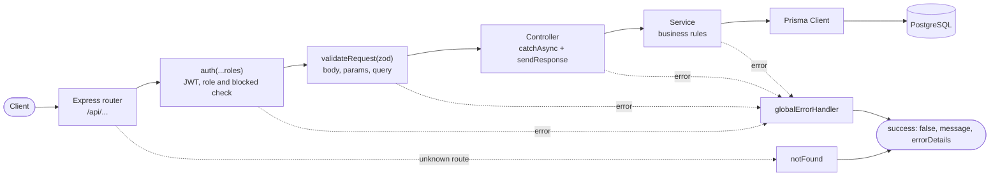
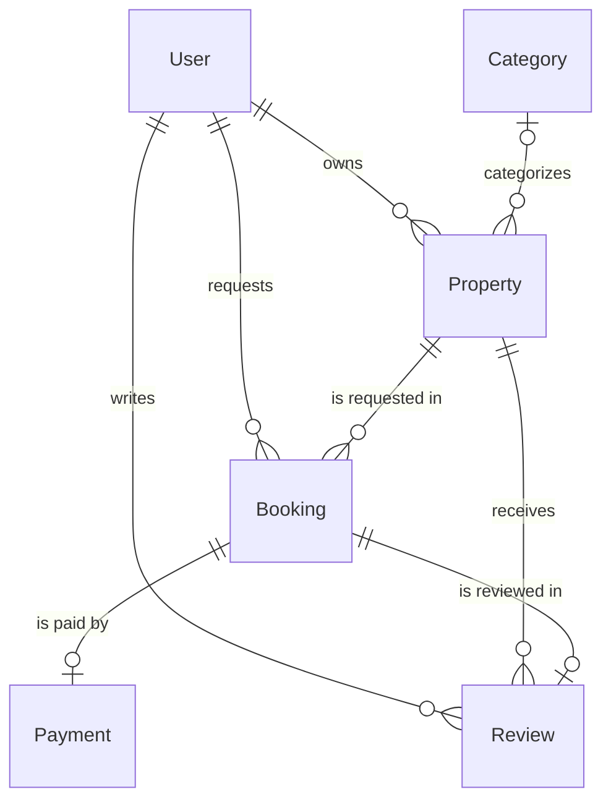
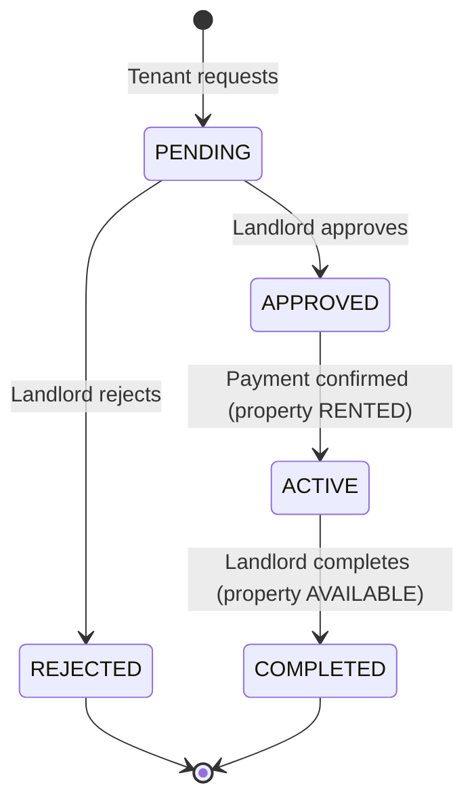
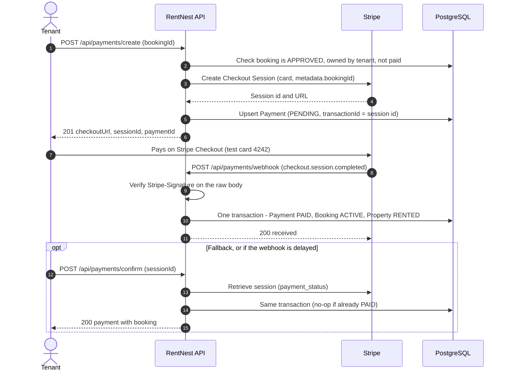

# 🏠 RentNest API

**Find & list rental properties with ease.** A REST API for a rental marketplace where landlords list properties, tenants request and pay for rentals through Stripe, and admins moderate the platform.


## 🔗 Links

|                        |                                                                                                                                         |
| ---------------------- | --------------------------------------------------------------------------------------------------------------------------------------- |
| **Live API**           | https://rentnest-backend-one.vercel.app                                                                                                 |
| **API docs (Postman)** | _Published Postman link coming soon._ Collection file: [`docs/RentNest.postman_collection.json`](docs/RentNest.postman_collection.json) |
| **API reference**      | [`docs/api.md`](docs/api.md)                                                                                                            |
| **Database diagram**   | [DrawSQL](https://drawsql.app/teams/zarif-hasan/diagrams/rentnest) · [`docs/ERD.md`](docs/ERD.md)                                       |
| **Demo video**         | _Coming soon_                                                                                                                           |

## 🔑 Test credentials

| Role     | Email                                               | Password       |
| -------- | --------------------------------------------------- | -------------- |
| Admin    | `admin@rentnest.com`                                | `Admin@123`    |
| Landlord | `landlord1@rentnest.com` · `landlord2@rentnest.com` | `Password@123` |
| Tenant   | `tenant1@rentnest.com` · `tenant2@rentnest.com`     | `Password@123` |

**Stripe test card:** `4242 4242 4242 4242`, any future expiry date, any CVC. Payments run in Stripe **test mode**; no real money is charged.

## Overview

RentNest is the backend for a rental marketplace with three roles, chosen at registration (admins are created by the seed):

- **Tenant:** browses and searches listings, requests a rental, pays once the landlord approves, and reviews the property after the rental is completed.
- **Landlord:** lists and manages properties, approves or rejects requests, completes rentals and reads tenant reviews.
- **Admin:** bans or unbans users, oversees all listings and rentals, and manages property categories.

## Features

<details open>
<summary><b>Public</b></summary>

- Browse properties with **search** (title, description, city, address), **filters** (city, state (`division`), property type, category, amenities, availability, price range), **pagination** and **sorting**
- Property details with category and landlord contact
- List categories and a property's reviews
- Register as tenant or landlord, log in (JWT)

</details>

<details>
<summary><b>Tenant</b></summary>

- Submit rental requests (only for available properties; duplicate pending requests are blocked)
- View own requests, filter by status (`PENDING`, `APPROVED`, `REJECTED`, `ACTIVE`, `COMPLETED`)
- Pay for an approved rental with **Stripe Checkout**; retry after an expired or failed session
- View payment history and payment details
- Review a property once per active or completed rental
- View and update own profile

</details>

<details>
<summary><b>Landlord</b></summary>

- Create, update and delete own properties; set availability
- List own properties (same filters and pagination as the public list)
- View requests for own properties (filter by status), approve or reject pending ones
- Mark an active, paid rental as completed (property becomes available again)
- Read reviews left on own properties

</details>

<details>
<summary><b>Admin</b></summary>

- List users with search, role/status filters and pagination
- Ban/unban users (blocked users can't log in or use protected routes; admins can't be blocked)
- View all properties and all rental requests (filter by status, paginated)
- Create, rename and delete categories

</details>

## Tech stack

| Technology                              | Used for                                                            |
| --------------------------------------- | ------------------------------------------------------------------- |
| **Node.js 24** + **Express 5**          | HTTP server and routing                                             |
| **TypeScript 7** (ES modules)           | Type safety across the codebase                                     |
| **PostgreSQL** (Neon / Prisma Postgres) | Relational database                                                 |
| **Prisma 7** + `@prisma/adapter-pg`     | Schema, migrations, type-safe queries (via the `pg` driver adapter) |
| **Zod 4**                               | Request validation (body, params, query)                            |
| **jsonwebtoken** + **bcryptjs**         | JWT authentication and password hashing                             |
| **Stripe**                              | Checkout Sessions, signed webhooks                                  |
| **http-status**                         | Named HTTP status codes                                             |
| **oxlint** + **Prettier**               | Linting and formatting                                              |
| **Vercel**                              | Serverless deployment (`api/index.ts`)                              |

## Architecture



**Module pattern:** each feature lives in `src/app/modules/<name>/` with the same files:

| File                                         | Responsibility                                                       |
| -------------------------------------------- | -------------------------------------------------------------------- |
| `<name>.route.ts`                            | Routes, plus the `auth` and `validateRequest` middleware for each    |
| `<name>.validation.ts`                       | Zod schemas shaped as `{ body, params, query }`                      |
| `<name>.controller.ts`                       | Thin handlers wrapped in `catchAsync`; respond via `sendResponse`    |
| `<name>.service.ts`                          | Business rules and Prisma queries; throw `AppError(status, message)` |
| `<name>.interface.ts` / `<name>.constant.ts` | Types and constants (filterable/sortable fields)                     |

## Project structure

<details>
<summary>Show tree</summary>

```
├── api/
│   └── index.ts                 # Vercel serverless entry (exports the Express app)
├── docs/
│   ├── api.md                   # Full API reference
│   ├── ERD.md                   # Database design, ERD, rental lifecycle
│   ├── schema.sql               # Generated DDL (for DrawSQL)
│   └── RentNest.postman_collection.json
├── prisma/
│   ├── schema/                  # Multi-file Prisma schema (one file per model + enums)
│   ├── migrations/              # SQL migrations
│   └── seed.ts                  # Idempotent seed: admin, demo users, categories, properties
├── src/
│   ├── server.ts                # Local entry (app.listen)
│   ├── app.ts                   # Middleware order, routes, 404 and error handlers
│   ├── config/                  # Environment config, Stripe client
│   ├── lib/prisma.ts            # Prisma client with the pg driver adapter
│   └── app/
│       ├── routes/index.ts      # Mounts every module router under /api
│       ├── middlewares/         # auth, validateRequest, globalErrorHandler, notFound
│       ├── errors/              # Zod, Prisma and JWT error mappers
│       ├── helpers/             # JWT and pagination helpers
│       ├── interfaces/          # Shared types (errors, pagination)
│       ├── types/express.d.ts   # Adds req.user to Express's Request
│       ├── utils/               # AppError, catchAsync, sendResponse, pick
│       └── modules/             # auth, user, category, property, rental, landlord, payment, review
├── prisma.config.ts             # Prisma CLI config (schema path, migrations, seed)
└── vercel.json                  # Rewrites every path to the Express function
```

</details>

## Database

Six tables: **User**, **Category**, **Property**, **Booking** (rental request), **Payment**, **Review**. Highlights:

- `Payment.bookingId` and `Review.bookingId` are **unique**: one payment and one review per rental.
- Foreign keys use **RESTRICT** on delete, so rental and payment history can't be lost; `Property.categoryId` uses **SET NULL**.
- Filter and sort columns are **indexed**: `Property(city, propertyType, rentAmount, ownerId)`, `Booking(tenantId, propertyId, bookingStatus)`, `Review(propertyId)`.



Every field, constraint, enum and design decision is documented in **[`docs/ERD.md`](docs/ERD.md)**.

### Rental lifecycle



`CANCELLED` exists in the `BookingStatus` enum but no endpoint sets it yet (see [limitations](#known-limitations--future-improvements)).

## Payment flow



- **Idempotent:** the transaction uses conditional updates (`WHERE paymentStatus != 'PAID'`), so whichever of webhook or confirm runs first does the work and the other changes nothing. A payment can never be processed twice.
- **Retries:** calling `/create` again reuses a still-open session or replaces an expired/failed one. `checkout.session.expired` and `checkout.session.async_payment_failed` mark the payment `FAILED`.
- **Raw body:** the webhook route is registered **before** `express.json()` so the signature check gets the exact bytes Stripe sent.

## API reference

Full details (bodies, validation rules, examples, error codes): **[`docs/api.md`](docs/api.md)**.

| Method | Path                                  | Role             | Description                                              |
| ------ | ------------------------------------- | ---------------- | -------------------------------------------------------- |
| GET    | `/`                                   | –                | Health check                                             |
| POST   | `/api/auth/register`                  | –                | Register as `TENANT` or `LANDLORD`                       |
| POST   | `/api/auth/login`                     | –                | Log in, returns a JWT                                    |
| GET    | `/api/auth/me`                        | any              | Current user's profile                                   |
| PATCH  | `/api/users/me`                       | any              | Update own name, email or phone                          |
| GET    | `/api/properties`                     | –                | Search, filter, paginate, sort properties                |
| GET    | `/api/properties/:id`                 | –                | Property details                                         |
| GET    | `/api/categories`                     | –                | List categories                                          |
| GET    | `/api/categories/:id`                 | –                | Category details                                         |
| GET    | `/api/reviews/property/:propertyId`   | –                | Reviews for a property                                   |
| POST   | `/api/rentals`                        | Tenant           | Submit a rental request                                  |
| GET    | `/api/rentals`                        | Tenant           | My requests (`?status=`)                                 |
| GET    | `/api/rentals/:id`                    | Tenant, Landlord | Request details (own / own property)                     |
| POST   | `/api/payments/create`                | Tenant           | Create Stripe Checkout Session (`/checkout` is an alias) |
| POST   | `/api/payments/confirm`               | Tenant           | Confirm a paid session                                   |
| GET    | `/api/payments`                       | Tenant           | My payment history                                       |
| GET    | `/api/payments/:id`                   | Tenant           | Payment details                                          |
| POST   | `/api/reviews`                        | Tenant           | Review an active or completed rental                     |
| GET    | `/api/landlord/properties`            | Landlord         | My properties                                            |
| POST   | `/api/landlord/properties`            | Landlord         | Create a property                                        |
| PUT    | `/api/landlord/properties/:id`        | Landlord         | Update a property / set availability                     |
| DELETE | `/api/landlord/properties/:id`        | Landlord         | Delete a property                                        |
| GET    | `/api/landlord/requests`              | Landlord         | Requests for my properties (`?status=`)                  |
| PATCH  | `/api/landlord/requests/:id`          | Landlord         | Approve or reject                                        |
| PATCH  | `/api/landlord/requests/:id/complete` | Landlord         | Complete an active rental                                |
| GET    | `/api/landlord/reviews`               | Landlord         | Reviews on my properties                                 |
| GET    | `/api/admin/users`                    | Admin            | List users                                               |
| PATCH  | `/api/admin/users/:id`                | Admin            | Ban / unban a user                                       |
| GET    | `/api/admin/properties`               | Admin            | All properties                                           |
| GET    | `/api/admin/rentals`                  | Admin            | All rental requests                                      |
| POST   | `/api/categories`                     | Admin            | Create a category                                        |
| PUT    | `/api/categories/:id`                 | Admin            | Rename a category                                        |
| DELETE | `/api/categories/:id`                 | Admin            | Delete an unused category                                |
| POST   | `/api/payments/webhook`               | Stripe           | Stripe webhook (signature verified)                      |

## Response & error format

**Success**

```json
{
  "success": true,
  "message": "Properties retrieved successfully",
  "meta": { "page": 1, "limit": 10, "total": 4, "totalPage": 1 },
  "data": []
}
```

`meta` appears only on paginated lists. Decimal fields such as `rentAmount` are returned as strings (`"180"`).

**Error:** every error uses the same shape:

```json
{
  "success": false,
  "message": "Validation failed",
  "errorDetails": [
    { "path": "email", "message": "Invalid email address" },
    { "path": "password", "message": "Password must be at least 6 characters" }
  ]
}
```

| Handled error                                                                                      | Status |
| -------------------------------------------------------------------------------------------------- | ------ |
| Zod validation (body, params, query)                                                               | 400    |
| Malformed JSON body                                                                                | 400    |
| Missing token / invalid token / expired token                                                      | 401    |
| Wrong role, blocked user, not the owner                                                            | 403    |
| Unknown route, missing record, Prisma **P2025**                                                    | 404    |
| Duplicate value (Prisma **P2002**), record still referenced (Prisma **P2003**), business conflicts | 409    |
| Unexpected errors (details hidden in production)                                                   | 500    |

## Filtering, search, pagination & sorting

`GET /api/properties` (and the landlord/admin property lists) accept:

| Param                  | Example                           | Notes                                                  |
| ---------------------- | --------------------------------- | ------------------------------------------------------ |
| `searchTerm`           | `searchTerm=lake`                 | title, description, city, address (case-insensitive)   |
| `city`, `division`     | `city=austin`, `division=texas`   | case-insensitive; `division` is the US state           |
| `propertyType`         | `propertyType=APARTMENT`          | `APARTMENT`, `HOUSE`, `STUDIO`, `VILLA`                |
| `categoryId`           | `categoryId=<uuid>`               |                                                        |
| `amenities`            | `amenities=wifi,parking`          | must have **all** listed                               |
| `availabilityStatus`   | `availabilityStatus=AVAILABLE`    | `AVAILABLE`, `RENTED`                                  |
| `minPrice`, `maxPrice` | `minPrice=100&maxPrice=500`       | monthly rent range                                     |
| `page`, `limit`        | `page=2&limit=10`                 | `limit` max 100                                        |
| `sortBy`, `sortOrder`  | `sortBy=rentAmount&sortOrder=asc` | `createdAt`, `rentAmount`, `area`, `bedrooms`, `title` |

```
GET https://rentnest-backend-one.vercel.app/api/properties?division=new%20york&propertyType=APARTMENT&amenities=wifi,elevator&minPrice=1000&maxPrice=5000&page=1&limit=5&sortBy=rentAmount&sortOrder=asc
```

Admin users (`searchTerm`, `role`, `userStatus`), admin rentals (`status`) and landlord reviews (`propertyId`) are paginated the same way. See [`docs/api.md`](docs/api.md#pagination-sorting).

## Getting started

### Prerequisites

- Node.js **24** (`nvm use` reads `.nvmrc`)
- A PostgreSQL database (e.g. a free [Neon](https://neon.tech) project)
- A Stripe account in **test mode** (and optionally the [Stripe CLI](https://docs.stripe.com/stripe-cli) for local webhooks)

### Setup

```bash
git clone https://github.com/Zarif207/rentnest-backend.git
cd rentnest-backend
npm install
cp .env.example .env        # fill in the values below
npm run db:migrate          # apply migrations to your database
npm run seed                # admin, demo users, categories, properties
npm run dev                 # http://localhost:4000
```

### Environment variables

| Variable                | Required | Description                                                                                                     |
| ----------------------- | -------- | --------------------------------------------------------------------------------------------------------------- |
| `DATABASE_URL`          | ✅       | PostgreSQL connection string                                                                                    |
| `JWT_ACCESS_SECRET`     | ✅       | Secret for signing access tokens (long random string)                                                           |
| `JWT_ACCESS_EXPIRES_IN` |          | Token lifetime (default `7d`)                                                                                   |
| `BCRYPT_SALT_ROUNDS`    |          | bcrypt cost factor (default `10`)                                                                               |
| `STRIPE_SECRET`         | ✅       | Stripe secret key (`sk_test_...`)                                                                               |
| `STRIPE_WEBHOOK_SECRET` | ✅       | Webhook signing secret (`whsec_...`)                                                                            |
| `CLIENT_SUCCESS_URL`    |          | Redirect after a successful payment; `session_id` is appended (default `http://localhost:3000/payment/success`) |
| `CLIENT_CANCEL_URL`     |          | Redirect when checkout is cancelled (default `http://localhost:3000/payment/cancel`)                            |
| `PORT`                  |          | Local port (default `4000`; not used on Vercel)                                                                 |
| `NODE_ENV`              |          | `production` hides unexpected error details (set automatically on Vercel)                                       |
| `SEED_ADMIN_EMAIL`      |          | Seeded admin email (default `admin@rentnest.com`)                                                               |
| `SEED_ADMIN_PASSWORD`   |          | Seeded admin password (default `Admin@123`)                                                                     |

### Stripe webhooks locally

```bash
stripe listen --forward-to localhost:4000/api/payments/webhook
```

Copy the printed `whsec_...` into `STRIPE_WEBHOOK_SECRET` and restart `npm run dev`. Without the Stripe CLI, call `POST /api/payments/confirm` with the session id after paying.

## Scripts

| Script                            | What it does                                      |
| --------------------------------- | ------------------------------------------------- |
| `npm run dev`                     | Start with hot reload (`tsx watch`)               |
| `npm run build`                   | `prisma generate` + type-check/compile with `tsc` |
| `npm start`                       | Start the server (`tsx src/server.ts`)            |
| `npm run typecheck`               | `tsc --noEmit`                                    |
| `npm run lint` / `lint:fix`       | oxlint                                            |
| `npm run format` / `format:check` | Prettier                                          |
| `npm run seed`                    | Seed the database (idempotent)                    |
| `npm run db:generate`             | Generate the Prisma client                        |
| `npm run db:migrate`              | `prisma migrate dev` (development)                |
| `npm run db:deploy`               | `prisma migrate deploy` (production)              |
| `npm run db:studio`               | Prisma Studio                                     |

## Deployment

The API runs on **Vercel** as a single serverless function:

- `api/index.ts` exports the Express app; `src/server.ts` (with `app.listen`) is only for local use.
- `vercel.json` rewrites every path to that function, so Express handles all routing.
- The build runs `npm run build` (`prisma generate && tsc`). Node **24.x** (`engines`).

**Steps**

1. Import the GitHub repo into Vercel. Pushes to `main` deploy to production.
2. Add the environment variables above in **Project → Settings → Environment Variables** (Production). `DATABASE_URL` comes from the connected database.
3. Apply migrations and seed against the production database from your machine (with `DATABASE_URL` pointing to it):
   ```bash
   npm run db:deploy
   npm run seed
   ```
4. In the Stripe Dashboard (test mode) add a webhook endpoint:
   - URL: `https://rentnest-backend-one.vercel.app/api/payments/webhook`
   - Events: `checkout.session.completed`, `checkout.session.expired`, `checkout.session.async_payment_failed`, `checkout.session.async_payment_succeeded`
   - Put its signing secret in `STRIPE_WEBHOOK_SECRET` and redeploy.

## Testing with Postman

1. **Import** [`docs/RentNest.postman_collection.json`](docs/RentNest.postman_collection.json).
2. **`baseUrl`** defaults to the live API (`https://rentnest-backend-one.vercel.app`). For local development, edit the collection variable `baseUrl` to `http://localhost:4000`.
3. Run **Auth → Login as Admin / Landlord / Tenant**. Tokens are saved automatically (`adminToken`, `landlordToken`, `tenantToken`, and `token` for the last login). Each folder uses the right token.
4. IDs (`propertyId`, `categoryId`, `rentalId`, `paymentId`, `sessionId`, `userId`) are captured from responses, so requests can be run in order.

**Suggested demo order**

1. Public → List properties (filters + pagination)
2. Landlord → Create property
3. Tenant → Submit rental request
4. Landlord → List requests → Approve
5. Tenant → Create payment → open `checkoutUrl`, pay with `4242 4242 4242 4242` → Confirm payment (or let the webhook do it)
6. Landlord → Mark rental as completed
7. Tenant → Create review
8. Admin → List users → Ban user → try logging in as that user
9. Error Examples folder (400, 401, 403, 404, 409)

## Technical challenges solved

<details>
<summary><b>ES modules on Vercel: import extensions</b></summary>

The project is `"type": "module"`. With `moduleResolution: "Bundler"`, TypeScript accepted imports like `./app/routes` and copied them unchanged into the compiled JavaScript. Node's ESM loader rejects extensionless and directory imports, so every request on Vercel crashed with `ERR_UNSUPPORTED_DIR_IMPORT`. Fix: explicit `.js` / `/index.js` specifiers in all relative imports, `importFileExtension = "js"` on the Prisma generator (the generated client had the same problem), a triple-slash reference so the `req.user` type augmentation is loaded from every entry point, and a `vercel.json` rewrite so `/api/*` reaches Express.

</details>

<details>
<summary><b>Idempotent payments: webhook + confirm</b></summary>

Both the Stripe webhook and `POST /payments/confirm` can mark a payment as paid, possibly at the same time. They share one function that runs a transaction with conditional `updateMany` calls (`paymentStatus != PAID`, `bookingStatus = APPROVED`). PostgreSQL row locking means exactly one caller updates the rows; the other sees zero affected rows and changes nothing. Expired or failed sessions mark the payment `FAILED`, and the tenant can retry with a new session.

</details>

<details>
<summary><b>Consistent error mapping</b></summary>

A single global error handler converts Zod errors, Prisma known errors (P2002/P2003/P2025/P2023), Prisma validation errors, JWT errors, malformed JSON, `AppError`s and unknown errors into `{ success: false, message, errorDetails[] }` with the correct status code. A JSON 404 handler covers unknown routes. Internal messages are hidden in production.

</details>

## Known limitations & future improvements

- **No file upload:** property images are URLs supplied in the request body.
- **No tenant cancellation:** `CANCELLED` is defined in the schema but no endpoint sets it; `Booking.isDeleted` (soft delete) is never set either.
- **Some lists are not paginated:** a tenant's rentals and payments, a landlord's requests, and public property reviews return all rows.
- **No refresh tokens:** access tokens last 7 days by default; the role is read from the token, so a role change applies at the next login.
- **No automated tests** (verification has been manual and end-to-end against real databases and Stripe test mode).
- **No rate limiting**, and CORS allows all origins.
- **No frontend:** Stripe's post-payment redirect URLs point to a client that doesn't exist yet (`CLIENT_SUCCESS_URL` / `CLIENT_CANCEL_URL`).
- **Linting without type information:** typescript-eslint doesn't support the TypeScript 7 compiler yet, so oxlint is used.

## Author

**Zarif Hasan** · [GitHub @Zarif207](https://github.com/Zarif207)

## License

[MIT](LICENSE) © 2026 Zarif Hasan
