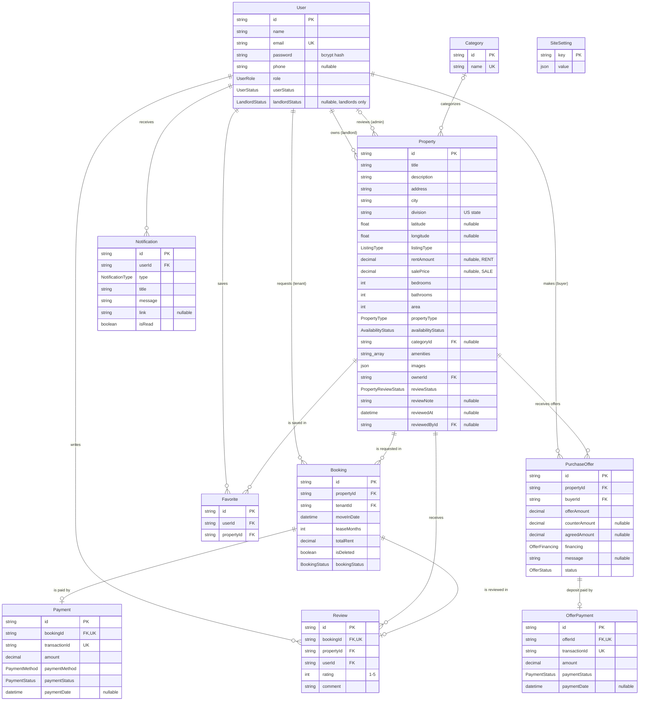

# RentNest: Database Design

PostgreSQL (Prisma Postgres in production) managed with Prisma 7, using a multi-file schema in [`prisma/schema/`](../prisma/schema). The full DDL is in [`schema.sql`](./schema.sql), generated offline from the Prisma schema.

- 11 tables · 14 enums · 15 foreign keys · 22 indexes (8 unique)
- IDs are UUID strings (`@default(uuid())`), except `SiteSetting`, which is keyed by `key`
- Every table has `createdAt` / `updatedAt` timestamps

## Entity-relationship diagram

## Tables

| Table           | Purpose                                                                                           | Notable constraints                                                                    |
| --------------- | ------------------------------------------------------------------------------------------------- | -------------------------------------------------------------------------------------- |
| `User`          | Every account: admin, landlord, tenant or observer                                                | `email` unique                                                                         |
| `Category`      | Listing categories                                                                                | `name` unique                                                                          |
| `Property`      | A listing for rent (`rentAmount`) or sale (`salePrice`), reviewed by an admin before it goes live | `ownerId` → User; `reviewedById` → User (nullable); `categoryId` → Category (nullable) |
| `Booking`       | A tenant's rental request and lease                                                               | `propertyId` → Property; `tenantId` → User; soft delete with `isDeleted`               |
| `Payment`       | The Stripe payment for one booking                                                                | `bookingId` unique (one payment per booking); `transactionId` unique                   |
| `Review`        | A tenant's review of a rental                                                                     | `bookingId` unique (one review per booking)                                            |
| `Favorite`      | A saved listing                                                                                   | `(userId, propertyId)` unique; cascades on user or property delete                     |
| `Notification`  | In-app notifications                                                                              | `userId` → User                                                                        |
| `PurchaseOffer` | A buyer's offer on a sale listing, with counter-offers                                            | `propertyId` → Property; `buyerId` → User                                              |
| `OfferPayment`  | The Stripe deposit for an accepted offer                                                          | `offerId` unique (one deposit per offer); `transactionId` unique                       |
| `SiteSetting`   | Key/value homepage settings edited by admins                                                      | `key` primary key                                                                      |

## Enums

| Enum                   | Values                                                                                                                       |
| ---------------------- | ---------------------------------------------------------------------------------------------------------------------------- |
| `UserRole`             | ADMIN, LANDLORD, TENANT, OBSERVER                                                                                            |
| `UserStatus`           | ACTIVE, BLOCKED                                                                                                              |
| `LandlordStatus`       | PENDING, APPROVED, REJECTED                                                                                                  |
| `PropertyReviewStatus` | PENDING, APPROVED, REJECTED                                                                                                  |
| `PropertyType`         | APARTMENT, HOUSE, STUDIO, VILLA                                                                                              |
| `AvailabilityStatus`   | AVAILABLE, RENTED, UNDER_CONTRACT, SOLD                                                                                      |
| `ListingType`          | RENT, SALE                                                                                                                   |
| `BookingStatus`        | PENDING, APPROVED, REJECTED, CANCELLED, ACTIVE, COMPLETED                                                                    |
| `PaymentMethod`        | CARD                                                                                                                         |
| `PaymentProvider`      | STRIPE                                                                                                                       |
| `PaymentStatus`        | PENDING, PAID, FAILED                                                                                                        |
| `OfferStatus`          | PENDING, COUNTERED, ACCEPTED, REJECTED, WITHDRAWN, DEPOSIT_PAID, COMPLETED, EXPIRED                                          |
| `OfferFinancing`       | CASH, MORTGAGE, OTHER                                                                                                        |
| `NotificationType`     | 23 values covering landlord approval, rentals, payments, reviews, account blocks, offers, deposits, sales and listing review |

## Lifecycles

- **Rental:** PENDING → (landlord) APPROVED / REJECTED → (tenant pays) ACTIVE → (landlord) COMPLETED.
- **Offer:** PENDING ⇄ COUNTERED → ACCEPTED → (buyer pays the deposit) DEPOSIT_PAID → (landlord) COMPLETED, and the property becomes SOLD. An offer can also be REJECTED, WITHDRAWN, or EXPIRED after 7 days without action.
- **Listing review:** each new or edited listing is PENDING until an admin sets it to APPROVED (live) or REJECTED (with a `reviewNote`).

## Visual diagram (DrawSQL)

Interactive diagram: [DrawSQL](https://drawsql.app/teams/zarif-hasan/diagrams/rentnest)

To update it, import [`schema.sql`](./schema.sql) into DrawSQL (PostgreSQL).
