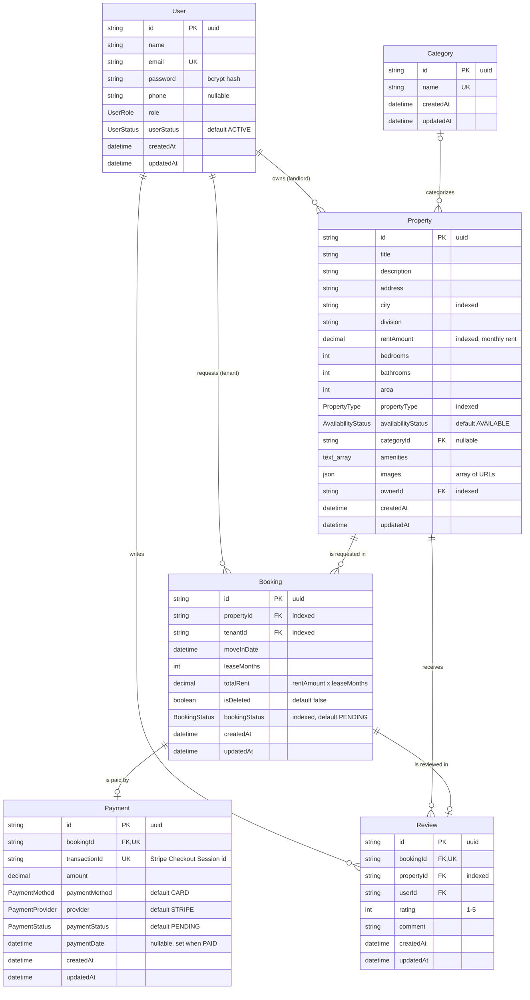
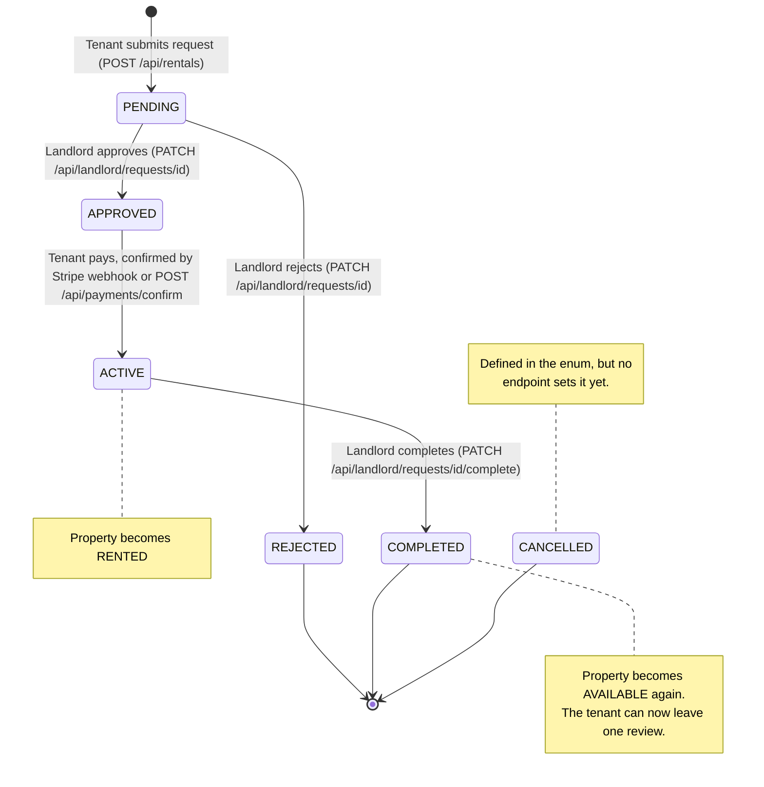

# RentNest: Database Design

PostgreSQL schema managed with Prisma 7 (multi-file schema in [`prisma/schema/`](../prisma/schema)). The full DDL is in [`schema.sql`](./schema.sql), generated from the Prisma schema.

- 6 tables · 8 enums · 8 foreign keys · 13 indexes (5 unique)
- IDs are UUID strings (`@default(uuid())`)
- Every table has `createdAt` / `updatedAt` timestamps

## Entity-relationship diagram

> The spec calls the rental table **RentalRequests**; in this schema it is the `Booking` model. The API exposes it as `/api/rentals`.

### Relationships

| Relationship        | Cardinality                     | Foreign key                      | On delete |
| ------------------- | ------------------------------- | -------------------------------- | --------- |
| User → Property     | 1 landlord : 0..n properties    | `Property.ownerId`               | RESTRICT  |
| Category → Property | 0..1 category : 0..n properties | `Property.categoryId` (nullable) | SET NULL  |
| User → Booking      | 1 tenant : 0..n bookings        | `Booking.tenantId`               | RESTRICT  |
| Property → Booking  | 1 property : 0..n bookings      | `Booking.propertyId`             | RESTRICT  |
| Booking → Payment   | 1 booking : 0..1 payment        | `Payment.bookingId` (unique)     | RESTRICT  |
| Booking → Review    | 1 booking : 0..1 review         | `Review.bookingId` (unique)      | RESTRICT  |
| Property → Review   | 1 property : 0..n reviews       | `Review.propertyId`              | RESTRICT  |
| User → Review       | 1 tenant : 0..n reviews         | `Review.userId`                  | RESTRICT  |

All foreign keys use `ON UPDATE CASCADE`.

## Tables

### User

Every account: tenants, landlords and admins.

| Field        | Notes                                                                                           |
| ------------ | ----------------------------------------------------------------------------------------------- |
| `email`      | **Unique.** Used for login.                                                                     |
| `password`   | bcrypt hash (`BCRYPT_SALT_ROUNDS`, default 10). Never returned by the API.                      |
| `role`       | `TENANT` or `LANDLORD` at registration. `ADMIN` accounts are created only by the seed.          |
| `userStatus` | `BLOCKED` users cannot log in and are rejected by the auth middleware on every protected route. |

**Design:** a single table with a `role` enum keeps authentication in one place; role checks happen in the `auth(...roles)` middleware. Users are never deleted through the API (only blocked), so the RESTRICT foreign keys pointing at `User` keep rental and payment history intact.

### Category

Property categories (seeded: Apartment, House, Studio, Villa). Managed by admins.

| Field  | Notes                                   |
| ------ | --------------------------------------- |
| `name` | **Unique.** Duplicate names return 409. |

**Design:** `Property.categoryId` is nullable with `ON DELETE SET NULL` at the database level. The API is stricter: deleting a category that is still assigned to properties returns 400, so properties never silently lose their category.

### Property

A listing owned by a landlord.

| Field                                | Notes                                                                                                                                                        |
| ------------------------------------ | ------------------------------------------------------------------------------------------------------------------------------------------------------------ |
| `ownerId`                            | The landlord. **Indexed.** Only the owner can update or delete the property.                                                                                 |
| `categoryId`                         | Optional link to `Category`.                                                                                                                                 |
| `city`, `propertyType`, `rentAmount` | **Indexed** because they are the main filter and sort fields of `GET /api/properties`.                                                                       |
| `amenities`                          | PostgreSQL `TEXT[]`. Filtering with `?amenities=wifi,parking` requires **all** listed amenities (`hasEvery`).                                                |
| `images`                             | JSON array of image URLs (validated as URLs).                                                                                                                |
| `availabilityStatus`                 | `AVAILABLE` / `RENTED`. Set to `RENTED` automatically when a rental is paid, back to `AVAILABLE` when it is completed; landlords can also set it with `PUT`. |
| `rentAmount`                         | `DECIMAL(65,30)`; serialised as a string in JSON (e.g. `"180"`).                                                                                             |

**Design:** deleting a property that has bookings or reviews is blocked by RESTRICT (the API returns 409) so rental and payment history is never lost.

### Booking (rental request)

A tenant's request to rent a property, and its whole lifecycle.

| Field                    | Notes                                                                                      |
| ------------------------ | ------------------------------------------------------------------------------------------ |
| `tenantId`, `propertyId` | **Indexed** for "my rentals" and "requests for my properties" queries.                     |
| `bookingStatus`          | See the lifecycle below. **Indexed** for `?status=` filters.                               |
| `totalRent`              | Calculated by the server as `rentAmount × leaseMonths` when the request is created.        |
| `isDeleted`              | Soft-delete flag. Every query filters on `isDeleted = false`, but no endpoint sets it yet. |

**Rules enforced by the service layer:**

- only `AVAILABLE` properties can be requested, and only by tenants (so a landlord cannot rent their own property)
- one `PENDING` request per tenant and property (409 on duplicates)
- only `PENDING` requests can be approved or rejected; approval fails (409) if the property is no longer available or another booking for it is already `APPROVED`/`ACTIVE`
- only `ACTIVE`, paid rentals can be completed

### Payment

One Stripe payment per booking.

| Field                        | Notes                                                                                                          |
| ---------------------------- | -------------------------------------------------------------------------------------------------------------- |
| `bookingId`                  | **Unique**, so a booking can never be paid twice.                                                              |
| `transactionId`              | **Unique.** The Stripe Checkout Session id (`cs_test_…`). Replaced if an expired or failed session is retried. |
| `paymentMethod` / `provider` | `CARD` / `STRIPE` (Checkout is limited to card payments).                                                      |
| `paymentStatus`              | `PENDING` → `PAID` (webhook or `/payments/confirm`) or `FAILED` (session expired / async payment failed).      |
| `paymentDate`                | Set when the payment becomes `PAID`.                                                                           |

**Design:** marking a payment `PAID`, the booking `ACTIVE` and the property `RENTED` happens in one transaction guarded by conditional updates, so the webhook and `/payments/confirm` can both run without double-processing.

### Review

A tenant's review of a property after a completed rental.

| Field        | Notes                                                |
| ------------ | ---------------------------------------------------- |
| `bookingId`  | **Unique**: exactly one review per completed rental. |
| `propertyId` | **Indexed** for property and landlord review lists.  |
| `rating`     | Integer 1–5 (validated).                             |
| `comment`    | 1–1000 characters (validated).                       |

**Design:** linking the review to a booking (not just the property) proves the reviewer actually rented the property and lets a tenant review again after a later, separate rental.

## Enums

| Enum                 | Values                                                                | Meaning                                                                       |
| -------------------- | --------------------------------------------------------------------- | ----------------------------------------------------------------------------- |
| `UserRole`           | `ADMIN`, `LANDLORD`, `TENANT`                                         | Account role; drives route authorisation.                                     |
| `UserStatus`         | `ACTIVE`, `BLOCKED`                                                   | Admins block/unblock users. Admins cannot block themselves or other admins.   |
| `PropertyType`       | `APARTMENT`, `HOUSE`, `STUDIO`, `VILLA`                               | Kind of property (filterable).                                                |
| `AvailabilityStatus` | `AVAILABLE`, `RENTED`                                                 | Whether the property can be requested.                                        |
| `BookingStatus`      | `PENDING`, `APPROVED`, `REJECTED`, `CANCELLED`, `ACTIVE`, `COMPLETED` | Rental lifecycle (below). `CANCELLED` is defined but no endpoint sets it yet. |
| `PaymentMethod`      | `CARD`                                                                | How the tenant paid.                                                          |
| `PaymentProvider`    | `STRIPE`                                                              | Payment gateway.                                                              |
| `PaymentStatus`      | `PENDING`, `PAID`, `FAILED`                                           | Payment state (the spec's "completed" is `PAID`).                             |

## Rental lifecycle

| Transition                          | Triggered by                                     | Side effects                                           |
| ----------------------------------- | ------------------------------------------------ | ------------------------------------------------------ |
| → `PENDING`                         | Tenant                                           | `totalRent` calculated                                 |
| `PENDING` → `APPROVED` / `REJECTED` | Landlord (property owner)                        | —                                                      |
| `APPROVED` → `ACTIVE`               | Stripe (webhook) or tenant (`/payments/confirm`) | Payment `PAID`, property `RENTED` (one transaction)    |
| `ACTIVE` → `COMPLETED`              | Landlord                                         | Property `AVAILABLE` (one transaction); review allowed |

## Visual diagram (DrawSQL)

Interactive diagram: https://drawsql.app/teams/zarif-hasan/diagrams/rentnest

To update it, import [`schema.sql`](./schema.sql) into DrawSQL (PostgreSQL).
